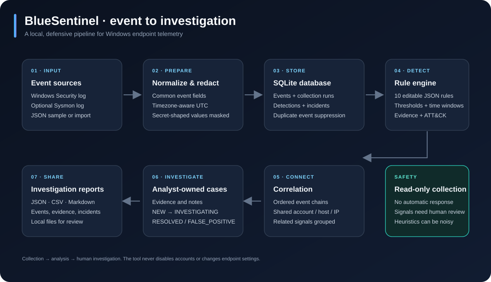

# BlueSentinel

BlueSentinel is a local, defensive Windows endpoint event collection and investigation tool. It normalizes Windows Security and optional Sysmon records, evaluates JSON-defined rules, stores events and findings in SQLite, groups related findings into analyst-owned incidents, and exports reports.

Detections are investigation signals. They do not prove compromise, and BlueSentinel does not remediate hosts, disable accounts, terminate processes, change audit policy, or change Windows security settings.



### How to read the diagram

BlueSentinel follows an explicit pipeline: collect a bounded set of events, normalize them to a shared UTC model and mask common secret-shaped values, store them in SQLite, then run the enabled JSON rules. Correlation connects signals only when configured time windows and identity fields match. The resulting incidents remain under analyst control and can be exported for review. Collection is read-only; alerts are leads that need human validation.

## How one event becomes an investigation

Think of the project as a small local security operations workflow:

1. **Collect:** `collect` reads supported Windows Security or Sysmon events, or imports synthetic JSON. Limits cap the scan so a collection run stays bounded.
2. **Normalize:** the collector maps provider-specific fields into one `SecurityEvent` shape. Timestamps become UTC; unknown fields stay in `raw_data` rather than being guessed.
3. **Store:** SQLite keeps the normalized event and suppresses exact duplicate imports. This database is the working history for later analysis.
4. **Detect:** `detect` loads enabled definitions from `rules/*.json`. Each rule describes its event IDs, time window, threshold, severity, ATT&CK references, and analyst guidance.
5. **Correlate:** a single rule may detect a pattern across events; correlation rules can also require an ordered chain, such as a logon followed by a privileged logon. Related detections are grouped into an incident when they share a known entity.
6. **Investigate and report:** analysts review evidence, add notes, and set incident status. Reports package the current events, detections, and cases in JSON, CSV, or Markdown.

Try the synthetic example first. Five failed logons for the same sample account should produce one brute-force signal and one incident without accessing a real Windows event log:

```powershell
py -3.9 -m backend.main --db .\demo.db collect --input .\sample_data\failed_logons.json
py -3.9 -m backend.main --db .\demo.db detect --output .\reports\demo.md --format markdown
py -3.9 -m backend.main --db .\demo.db incidents list
```

The key files to explore are `backend/cli/commands.py` for the user workflow, `backend/detection/engine.py` for rule execution, `rules/` for editable detections, and `backend/storage/` for SQLite persistence. The `tests/` directory shows the expected behavior using mocked Windows APIs and synthetic events.

## Features

- Read-only collection from the Windows Security Event Log and optional Sysmon Operational channel.
- Bounded scans, time filters, explicit collection summaries, and safe handle cleanup.
- UTC `SecurityEvent` model, event field mapping, preserved raw inserts, and basic secret-shaped value redaction.
- JSON rules for brute-force activity, a successful logon after repeated failures, privileged logons, suspicious process command markers, account/group changes, and high-volume Sysmon network activity.
- Ordered, entity-keyed event-chain correlation alongside alert grouping, plus an incident lifecycle with notes and evidence links.
- SQLite persistence with schema initialization, legacy event-table upgrades, indexes, and duplicate suppression.
- JSON, CSV, and Markdown investigation reports.
- MITRE ATT&CK mappings where the observed signal supports a mapping.
- Portable JSON sample import and mocked Windows API tests.

## Requirements and installation

- Python 3.9 or newer (the initial compatibility target is Python 3.9).
- Windows 10/11 for live event collection.
- pywin32 is installed only on Windows. Sysmon is optional.

Create a project-local environment and install development dependencies:

```powershell
py -3.9 -m venv .venv
.\.venv\Scripts\Activate.ps1
python -m pip install -r requirements-dev.txt
```

The ordinary unit and integration tests use synthetic events and API mocks. They do not require Administrator access or access to a real Security log.

## Quick start

Run commands from the project root. The global `--db` and `--rules` options go before the subcommand.

```powershell
py -3.9 -m backend.main --help
py -3.9 -m backend.main rules validate
py -3.9 -m backend.main --db .\bluesentinel.db collect --source security --max-events 100 --max-records 500
py -3.9 -m backend.main --db .\bluesentinel.db detect --output .\reports\latest.json --format json
py -3.9 -m backend.main --db .\bluesentinel.db incidents list
py -3.9 -m backend.main --db .\bluesentinel.db status
```

Live Security log collection attempts to enable `SeSecurityPrivilege` in the current process token. The account must already have that right. BlueSentinel does not grant rights or change policy. If the privilege or log access is missing, the command reports an error; consult an administrator and configure rights manually only if that is appropriate for your environment.

Check whether a channel can be opened without reading records:

```powershell
py -3.9 -m backend.main test-connection --source security
py -3.9 -m backend.main test-connection --source sysmon
```

The Sysmon command reports an unavailable or unreadable channel clearly. It does not install Sysmon or change its configuration.

## Portable synthetic demo

Sample import works without Windows APIs:

```powershell
py -3.9 -m backend.main --db .\demo.db collect --input .\sample_data\failed_logons.json
py -3.9 -m backend.main --db .\demo.db detect --output .\reports\demo.md --format markdown
py -3.9 -m backend.main --db .\demo.db incidents list
```

The sample contains five synthetic failed logons for one account in less than one minute. The expected result is one brute-force detection and one new incident. Re-running detection does not create duplicate detection or incident rows.

More mixed Security and Sysmon examples are under `sample_data/events/`.

Run both mixed synthetic fixtures together to exercise the cross-source rules:

```powershell
py -3.9 -m backend.main --db .\mixed-demo.db collect --input .\sample_data\events\mixed_windows_events.json
py -3.9 -m backend.main --db .\mixed-demo.db collect --input .\sample_data\events\sysmon_events.json
py -3.9 -m backend.main --db .\mixed-demo.db detect --output .\reports\mixed-demo.md --format markdown
py -3.9 -m backend.main --db .\mixed-demo.db incidents list
```

This synthetic workflow exercises brute-force, suspicious-login, process, account-change, and ordered event-chain signals without reading the machine's real event logs.

## Collection and supported events

`collect --source security` supports Windows Security event IDs: 4624, 4625, 4634, 4648, 4672, 4688, 4720, 4722, 4728, 4732, and 4740. `--max-events` limits matching supported events; `--max-records` limits all scanned log records. `--since` accepts a timezone-aware ISO 8601 timestamp.

`collect --source sysmon` is optional and reads IDs 1, 3, 7, 8, 10, 11, 12, 13, 14, and 22 from `Microsoft-Windows-Sysmon/Operational`. It also supports the same bounds and time filter. The collector maps known insertion-string positions; raw records are retained for follow-up analysis. Event layouts can vary by Windows/Sysmon version and should be validated in the target lab.

Both collectors close handles on success and failure, skip malformed individual records with a warning, and distinguish an empty successful scan from collection failure. `test-connection` only opens and closes the channel; it does not verify that records can be read. Collection summaries are persisted without event payloads.

JSON/sample events must include an integer `event_id` and an ISO 8601 `timestamp`. A timestamp without an offset is interpreted as UTC; an offset timestamp is converted to UTC. Unknown source and identity fields remain empty rather than being guessed.

## Detection rules

Rule definitions live in `rules/*.json`. Each rule has an ID, name, description, source scope, event IDs/conditions, detector, options, severity, enabled flag, ATT&CK tactic/technique metadata, and recommended analyst actions.

```powershell
py -3.9 -m backend.main rules list
py -3.9 -m backend.main rules validate
```

Current rule behavior:

| Rule | Signal |
| --- | --- |
| Brute Force Detection | Five or more Event ID 4625 records for one domain-scoped username or one source IP in 60 seconds. Identical username/IP evidence is reported once. |
| Successful Login After Failures | A 4624 for a username after at least three 4625 records in five minutes. |
| Privileged Logon | Event ID 4672; review whether the privileged activity is expected. |
| Suspicious Process Command | Sysmon 1 or Security 4688 with a configured command marker such as encoded PowerShell. |
| Account or Group Change | Events 4720, 4722, 4728, or 4732. Mapping is event-specific; account enablement alone is not forced into ATT&CK. |
| High-Volume Network Activity Signal | At least 50 Sysmon 3 records for one username or source IP in 60 seconds. This is a low-severity volume signal, not a C2 verdict. |
| Login then Privileged Logon | Event 4624 followed by 4672 for the same account SID within five minutes. |
| Process then Network | Sysmon 1 or Security 4688 followed by Sysmon 3 attributed to the same process within two minutes. |
| Account Creation then Group Addition | Event 4720 followed by 4728 or 4732 for the same target account SID within one hour. |
| Failed Logons then Lockout | Event 4625 followed by 4740 for the same domain-qualified username, when the domain is present, within five minutes. |

Thresholds, windows, sources, conditions, indicators, severity, mappings, and recommendations are stored in JSON. Unknown detector types or malformed values fail rule validation rather than being silently ignored.

## Incidents and reports

`detect` stores findings, identifies configured ordered event chains by explicit account SID, username, or process keys, and groups nearby alerts by their shared account, IP, host, or process keys into incidents. A chain does not match when the configured identity is missing. Incidents begin in `NEW`; an analyst can update them to `INVESTIGATING`, `RESOLVED`, or `FALSE_POSITIVE`, and append notes. BlueSentinel never closes an incident automatically.

```powershell
py -3.9 -m backend.main --db .\bluesentinel.db incidents list
py -3.9 -m backend.main --db .\bluesentinel.db incidents show 1
py -3.9 -m backend.main --db .\bluesentinel.db incidents update 1 --status INVESTIGATING --note "Reviewed against the lab change window."
py -3.9 -m backend.main --db .\bluesentinel.db report --format markdown --output .\reports\investigation.md
```

Reports include collection dates, host names when available, event and detection counts, severity distribution, incident status, evidence, recommendations, and supported ATT&CK mapping. JSON includes normalized events and finding evidence; CSV includes summary, detection, and incident rows. Reports distinguish an analytical signal from confirmed compromise.

## Configuration and data handling

Use a JSON configuration file or environment variables. A template is available at `config.example.json`.

```powershell
$env:BLUESENTINEL_DATABASE = ".\bluesentinel.db"
$env:BLUESENTINEL_RULES = ".\rules"
$env:BLUESENTINEL_LOG_LEVEL = "INFO"
py -3.9 -m backend.main status
```

The local SQLite database contains security telemetry and may include usernames, domains, account SIDs, hostnames, IP addresses, and command-line data. Keep it in an access-controlled location. BlueSentinel redacts common password/token-shaped values, but that filter is not a guarantee that every secret format will be recognized; review and protect exported files. Database and generated report files are ignored by Git by default.

## Architecture

- `backend/collectors/`: Windows Security, optional Sysmon, and JSON sample input.
- `backend/normalization/`: shared model conversion and sensitive-value redaction.
- `backend/models/`: security events, detections, correlation groups, and incidents.
- `backend/detection/`: JSON rule validation and detector execution.
- `backend/correlation/`: time-based alert grouping.
- `backend/incidents/`: SQLite-backed analyst workflow.
- `backend/storage/`: schema initialization and event/detection repositories.
- `backend/reporting/`: JSON, CSV, and Markdown exports.
- `backend/cli/`: analyst commands.
- `docs/`: architecture, setup, detection, security, and roadmap.

## Testing

```powershell
py -3.9 -m pytest -q
```

Windows APIs are mocked in automated tests. The suite uses synthetic fixtures, temporary SQLite files, and output files in pytest's temporary directory. The manual collector probe is `tests/manual_test_windows_collector.py`; it is not part of pytest's default `test_*.py` discovery and should only be run on an authorized Windows machine.

## Limitations

- Event field mapping relies on known Windows/Sysmon insertion-string order. Validate it against the event channel version in an authorized lab; unsupported layouts remain in `raw_data` but may not populate normalized fields.
- Process and network detections are heuristic. Normal administrative activity can trigger them.
- Network volume uses a fixed configurable threshold, not a learned host baseline.
- ATT&CK mappings describe a detection's analytic relationship, not attribution or confirmation.
- This is a local single-host learning and investigation tool, not a production EDR or centralized monitoring service.
- No dashboard, REST API, scheduled collection, threat-intelligence feed, or automatic response is implemented.

## Roadmap

See [docs/roadmap.md](docs/roadmap.md) for planned extensions such as richer event XML parsing, Sigma-inspired rule import, baselines, multi-host ingestion, and a dashboard after the core pipeline matures.

## Security and contributions

See [SECURITY.md](SECURITY.md), [docs/security.md](docs/security.md), and [CONTRIBUTING.md](CONTRIBUTING.md). Use BlueSentinel only on systems and logs you are authorized to inspect.

## License

MIT. See [LICENSE](LICENSE). The MIT License allows broad reuse and redistribution while requiring preservation of the copyright and license notice; it provides the software without warranty.
